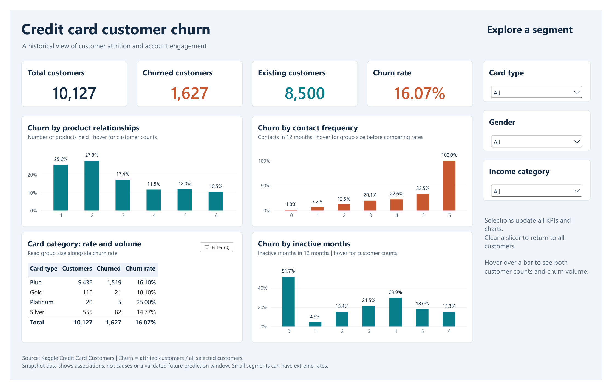

# Credit Card Customer Churn Analysis and Prediction

Analyze credit card customer attrition with Python and SQL, explore customer segments in Power BI, and prepare inputs for a predictive model.

**Status:** Exploratory analysis, SQL segmentation, and the historical Power BI dashboard are complete. Model inputs, a stratified train/test split, and categorical encoding are prepared. Model training, evaluation, and risk scoring remain planned.

**Power BI dashboard:** [Download the report](powerbi/Credit_Card_Churn_Dashboard.pbix) · [Opening and refresh instructions](powerbi/README.md) · [DAX measures](powerbi/measures.dax)

**Portfolio case study:** [Business findings, recommendations, and evaluation plan](docs/case_study.md) · [Supporting SQL](sql/retention_segments.sql)



[View the full-size preview](powerbi/images/churn_overview.png) · [Download the static PDF](powerbi/Churn_Overview.pdf). These previews show all customers; use the PBIX for interactive filtering.

| Notebook | Contents | Open |
| --- | --- | --- |
| [01_data_analysis.ipynb](01_data_analysis.ipynb) | Data checks, preparation, charts, and SQL segmentation | [Google Colab](https://colab.research.google.com/github/mehakgupta0406/credit-card-customer-churn/blob/main/01_data_analysis.ipynb) |
| [02_model_training.ipynb](02_model_training.ipynb) | Model inputs, train/test split, and one-hot encoding | [Google Colab](https://colab.research.google.com/github/mehakgupta0406/credit-card-customer-churn/blob/main/02_model_training.ipynb) |

## Business objective

Identify customer characteristics and account activity patterns associated with churn. The planned model will estimate churn risk to help a retention team prioritize customers for investigation and outreach.

The analysis addresses:
- How common is churn?
- How do transaction activity and inactivity differ between existing and attrited customers?
- How does churn vary by card category, product count, contact frequency, and credit utilization, and account tenure?

## Dataset

Source: [Credit Card Customers by Sakshi Goyal on Kaggle](https://www.kaggle.com/datasets/sakshigoyal7/credit-card-customers), provided as `BankChurners.csv`.

The source file contains **10,127 customers and 23 columns**, covering demographics, account tenure, product relationships, transaction activity, credit limits, and utilization.

| Customer status | Customers | Share |
| --- | ---: | ---: |
| Existing Customer | 8,500 | 83.93% |
| Attrited Customer | 1,627 | 16.07% |

The derived target, `Churn`, is **1 for attrited customers** and **0 for existing customers**.

## Tools

| Tool | Role |
| --- | --- |
| Python and pandas | Data inspection, preparation, and analysis |
| Matplotlib | Comparison charts |
| SQLite and SQL | Customer segmentation and churn-rate calculations |
| scikit-learn | Train/test splitting and categorical encoding; model training and evaluation planned |
| Power BI, Power Query, and DAX | Interactive historical churn dashboard, typed data import, and filter-aware KPI measures |

## Analysis completed

- Checked dataset dimensions, column types, blank values, and duplicate customer IDs.
- Found no blank values or duplicate customer IDs. Retained explicit `Unknown` categories in education, marital status, and income.
- Removed the two supplied `Naive_Bayes_Classifier...` columns to avoid target leakage in later modeling.
- Created the binary churn target.
- Plotted average transaction count, transaction amount, and inactive months by customer status.
- Loaded the prepared data into a SQLite `customers` table.
- Used SQL to calculate customer counts, churn counts, and churn rates across six segmentation dimensions, including account tenure.

## Power BI dashboard

The [Churn overview report](powerbi/Credit_Card_Churn_Dashboard.pbix) contains:

- Four KPI cards: total customers, churned customers, existing customers, and churn rate.
- Churn-rate charts by product relationships, contact frequency, and inactive months, with customer and churn counts in tooltips.
- A card-category table comparing customer counts, churn volume, and churn rate.
- Dropdown slicers for card type, gender, and income category that update the page together.
- Source and interpretation notes, including the limitations of small segments and snapshot data.

The model includes six explicit [DAX measures](powerbi/measures.dax). The four headline measures appear as KPI cards; average transactions and average utilization are available for further analysis.

Validated against the prepared CSV:

| Selection | Total customers | Churned | Existing | Churn rate |
| --- | ---: | ---: | ---: | ---: |
| All customers | 10,127 | 1,627 | 8,500 | 16.07% |
| Blue cardholders | 9,436 | 1,519 | 7,917 | 16.10% |

The report contains historical analysis. Predicted churn probabilities and model performance are not included. See the [Power BI guide](powerbi/README.md) for opening, filtering, and refreshing the report on another computer.

## Modeling preparation completed

The modeling notebook loads `bank_churn_prepared.csv`, containing 10,127 rows and 22 columns after removing the two supplied classifier outputs and adding `Churn`.

- Separated **19 input features** from the binary churn target.
- Excluded `CLIENTNUM`, `Attrition_Flag`, and `Churn` from the input features.
- Created a stratified **80/20 split** with `random_state=42`: **8,101 training customers** and **2,026 test customers**.
- Identified **14 numerical** and **5 categorical** input columns.
- Applied `OneHotEncoder(handle_unknown="ignore")` to categorical columns and passed numerical columns through unchanged.
- Fitted the encoder on training data only and reused it to transform the test set.
- Produced **37 encoded input features** in each set.

No trained model or performance metrics are included in the uploaded modeling notebook yet.

## Key findings

| Area | Observed result | Interpretation |
| --- | --- | --- |
| Product relationships | Churn is 27.84% for customers with two products versus 10.50% for those with six. | Fewer product relationships are generally associated with higher churn. |
| Contact frequency | Churn rises from 1.75% at zero contacts to 33.52% at five contacts. All 54 customers with six contacts churned. | The six-contact pattern needs investigation; contact reasons and timing are unavailable. |
| Credit utilization | Churn is 21.16% below 25% utilization, 6.11% at 50% to below 75%, and 15.69% at 75% and above. | The relationship is not consistently increasing or decreasing. |
| Card category | Platinum has 25% churn among only 20 customers. Blue accounts for 1,519 churned customers. | Compare group size and churn volume alongside rates. |
| Inactivity | Churn increases from 4.48% at one inactive month to 29.89% at four, then declines. | Inactivity alone does not explain churn. The zero-month group has only 29 customers. |

These findings describe associations. They do not establish the causes of churn or prove that a retention action will work.

## Business recommendations

- **Investigate low engagement.** Customers below 25% credit utilization account for 1,232 churners, or 75.72% of all observed churn. Research service or onboarding barriers before proposing an intervention.
- **Audit contact timing.** Review the six-contact group and collect contact reasons, resolution status, and dates relative to closure before treating contact frequency as an early churn signal.
- **Balance rate with volume.** Blue cardholders account for 93.36% of churn volume, while Platinum contributes five churners. Investigate behavioral subsegments within the large Blue population rather than prioritizing a small group solely for its high rate.

These are proposed actions. Their retention impact would need to be tested on a new cohort with a defined future churn window and a control group. See the [case study](docs/case_study.md) for the evidence, evaluation measures, and limitations. Segment populations overlap and should not be summed.

## Run the notebooks

1. Download and unzip `BankChurners.csv` from the dataset source.
2. Open `01_data_analysis.ipynb` in Jupyter or Google Colab.
3. Place the CSV in the notebook's working directory. In Colab, upload it to the session's Files panel.
4. Run the analysis cells from top to bottom.
5. Run through the final export cell. It automatically writes `bank_churn_prepared.csv` and reports **10,127 rows, 22 columns, 1,627 churned customers, and 16.07% churn** for the original source data.

6. Open `02_model_training.ipynb` and place the exported CSV in its working directory. For separate Colab sessions, download the prepared CSV from the analysis session and upload it to the modeling session.
7. Run the modeling cells from top to bottom.

For a local environment, use Python 3.12 (tested with 3.12.14). Install the pinned direct dependencies in an isolated environment. In Windows PowerShell, from the repository folder:

```powershell
python -m venv .venv
.\.venv\Scripts\python.exe -m pip install -r requirements.txt
.\.venv\Scripts\python.exe -m notebook
```

On macOS/Linux, use `.venv/bin/python` in place of `.\.venv\Scripts\python.exe`.

### Execute both notebooks without opening Jupyter

Put `BankChurners.csv` in the repository folder, then run:

```powershell
.\.venv\Scripts\python.exe scripts/run_notebooks.py
```

The [runner](scripts/run_notebooks.py) uses a separate fresh kernel for each notebook, runs notebook 01 before notebook 02, and stops if a cell fails. It preserves the source notebooks and writes executed copies to `artifacts/executed_notebooks/`. The generated CSV and `customer_churn.db` are written beside the input CSV. Use `--data-dir` and `--output-dir` to select other locations.

SQLite support is included with Python. Rerunning the table-loading cell replaces the `customers` table. The source CSV must be downloaded separately. Local datasets, database files, environments, and execution copies are excluded by `.gitignore`.

### Reproduction checks

Both notebooks were executed from the original Kaggle CSV using the pinned dependencies and separate fresh kernels, with no cell errors. The generated prepared dataframe matched the dashboard's source dataframe. The model preparation produced **8,101 training rows**, **2,026 test rows**, and **37 encoded features** in each set. The committed notebook outputs come from this run.

## Next steps

- Add feature scaling and train a logistic regression baseline using training data only.
- Compare the baseline with a tree-based classifier.
- Evaluate on a held-out test set using precision, recall, and precision–recall metrics, alongside accuracy.
- Generate customer risk scores and prepare report tables.
- Extend the existing Power BI dashboard with model results after training and evaluation are complete.

## Limitations

The dataset is a customer snapshot without a dated sequence of outcomes. It supports retrospective churn classification, but cannot verify whether currently existing customers later leave or establish a specific future prediction window.

The classes are imbalanced: predicting every customer as existing would achieve 83.93% accuracy while detecting no churners. Model evaluation must account for this. Retention impact would require a separate experiment.
